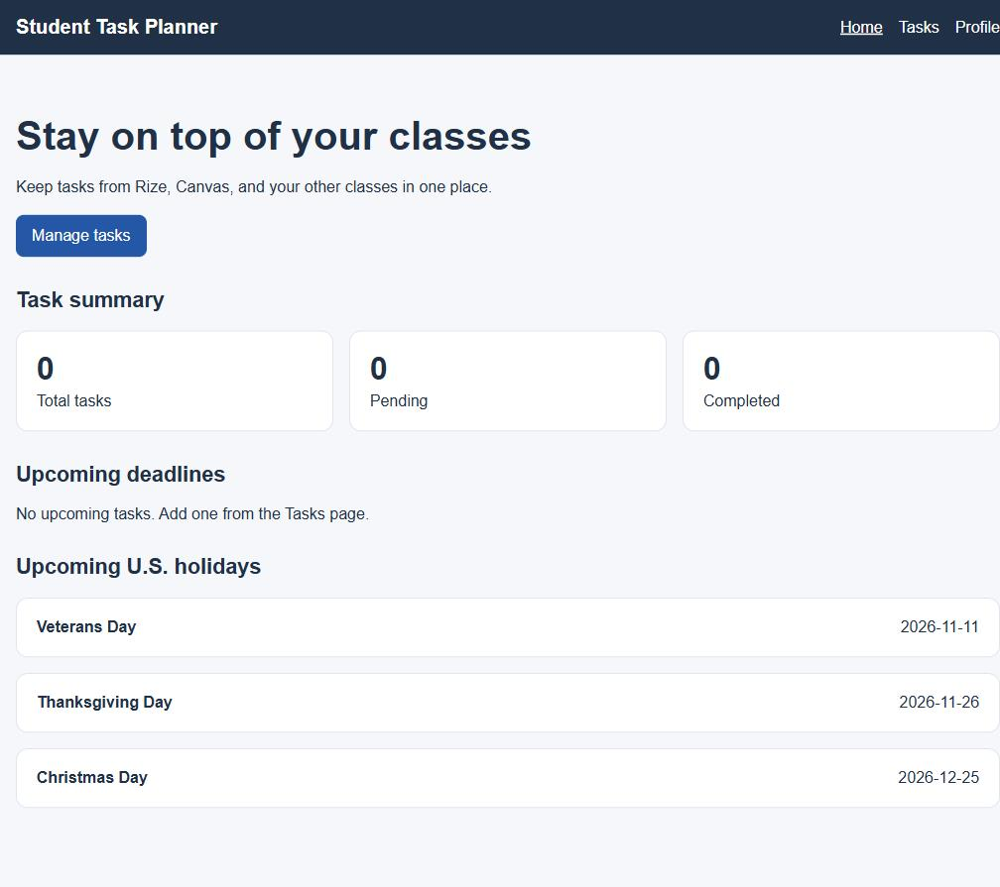
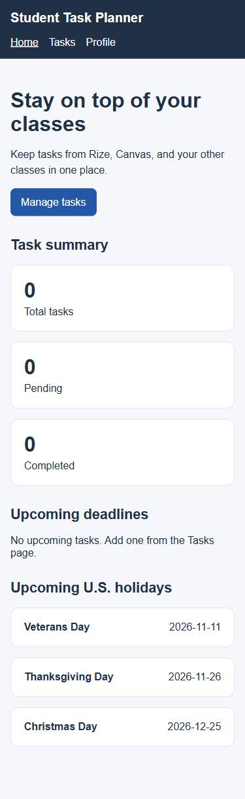
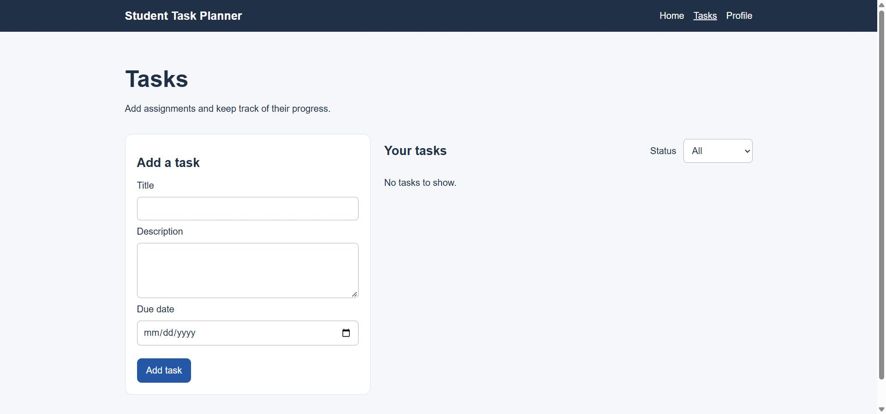

# Student Task Planner

Student Task Planner is a frontend MVP for entering assignments from Rize, Canvas, and other classes in one place. It tracks a task's title, description, due date, and completion status, and shows upcoming U.S. public holidays.

## Technologies

Vite, React, React Router, TypeScript, CSS, Nager.Date, Vitest, and React Testing Library.

## Run locally

1. Run `npm install` to install the project dependencies.
2. Run `npm run dev` to start the local Vite server, then open the URL it prints.
3. Run `npm test` for the six basic tests, `npm run typecheck` for prop and state type checks, `npm run lint` for JavaScript checks, or `npm run build` to type-check and create the production build.

## Pages

- `/`: task totals, upcoming deadlines, and up to three upcoming U.S. holidays.
- `/tasks`: add a task, view tasks, and filter by completion status.
- `/tasks/:taskId`: view, edit, complete, or delete a task. Unknown IDs show “Task not found.”
- `/profile`: demo profile with a link to Tasks.
- Other URLs show the 404 page.

## Holidays API

Home uses `fetch` in `src/services/holidayService.ts` to call the public Nager.Date `/api/v3/PublicHolidays/{year}/US` endpoint. It requests the next year if needed to show three upcoming dates. The holiday section shows loading, empty, and error states, and has a Retry button. Tasks still work if this request fails. No API key is required.

## Screenshots

These are real captures of the running app:

## Limitations

This MVP stores tasks in React Context while the app is open. Tasks remain when navigating between pages but reset after a full page refresh. Users enter tasks manually; there is no Canvas or Rize account connection.

## Deployment

Live application: https://student-task-planner-nine.vercel.app/

Import this GitHub repository into Vercel as a Vite project. Use the repository root, `npm run build`, and the `dist` output directory. The `vercel.json` rewrite lets React Router open URLs such as `/tasks` directly. No environment variables are needed for the public holidays API.

## Future Improvements

The final version can add Supabase, registration, login, and protected routes. Row Level Security policies should check each task's owner using `user_id`, while administrator permissions should be verified in the backend.
